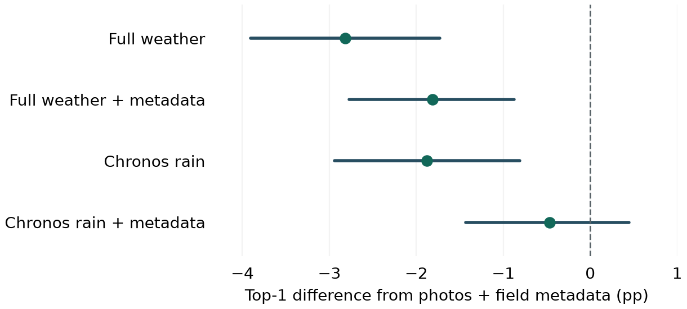

[← Back to portfolio](../)

# Does recent weather help identify mushrooms from photos?

**Habitat, substrate, and calendar month gave the highest identification accuracy.** On 4,687 FungiTastic-Mini sightings from 2022, a frozen DINOv2-Base image model reached 79.50% top-1 accuracy. Adjusting its species scores using those three fields raised accuracy to **80.71%**. With photos and weather alone, the best result was **78.92%**. Photos with both metadata and pretrained rain features produced the highest macro-F1, **60.27%**.

## The comparison

Weather can help explain *when* mushrooms appear. I wanted to know whether the preceding weather also helps tell *which species* is in a photograph once someone has found it. Earlier work used a Q-Former to combine DINOv2 image features and ecological metadata for few-shot fungi recognition. I tested whether the sequence of daily weather leading up to each sighting helped on the closed-set FungiTastic-Mini task. [Lu et al., FungiCLEF 2025](https://ceur-ws.org/Vol-4038/paper_247.pdf) · [FungiTastic dataset and benchmark](https://github.com/BohemianVRA/FungiTastic)

I treated a sighting as one example. A cap photo and a gill photo of the same specimen contribute to one species prediction. Each classifier ranked all 215 categories on the same 4,687 sightings (9,412 photos). I selected checkpoints by sighting top-1, the fraction of sightings whose first prediction was correct. As a secondary metric, I averaged species-level F1 across the 193 categories present in validation, giving each species equal weight.

## What do the photos and field notes tell us?

I fit separate linear classifiers on frozen DINOv2-Small and Base features. Base scored 79.18% sighting top-1 versus 74.65% for Small, so I used Base for the remaining trials. Both metadata methods saw the same three fields. The frequency method adjusted the image classifier’s species scores using counts from training. The learned method gave each field its own eight-dimensional embedding and concatenated those vectors with the pooled photo features before classification. [Danish Fungi metadata method, §5.2](https://openaccess.thecvf.com/content/WACV2022/papers/Picek_Danish_Fungi_2020_-_Not_Just_Another_Image_Recognition_Dataset_WACV_2022_paper.pdf)

| Model inputs and method | Top-1 | Macro-F1 |
|---|---:|---:|
| Photos | 79.50% | 55.22% |
| Photos + field-frequency adjustment | **80.71%** | 58.79% |
| Photos + learned field embeddings | 80.61% | **58.93%** |

The frequency adjustment corrected 232 of the photo model’s errors and introduced 175, a net gain of 57 sightings. The two metadata methods finished five correct sightings apart. I carried the frequency adjustment forward and applied the same fixed adjustments to each weather model’s predictions.

## Weather and fusion trials

I matched each sighting to the nearest ERA5 grid cell and took the previous 30 complete local days of low temperature, high temperature, and total precipitation. This covered all 4,687 validation sightings and 25,785 of the 25,786 training sightings. One training sighting lacked coordinates. The visual and metadata baselines used the full training set.

In the first weather model, a two-layer transformer encoded one token per day. Each photo supplied a query to one four-head cross-attention block, which read the weather tokens before I averaged the photo representations. The **shared-query control** learned one query for all photos. Two views of the same specimen then retrieved the same weather summary, while the classifier still saw each view’s visual features.

| Weather input and query | Top-1 | Macro-F1 | Top-1 with field metadata | Macro-F1 with field metadata |
|---|---:|---:|---:|---:|
| Daily lows, highs and rain · photo query | 77.90% | 55.50% | 78.90% | 58.97% |
| Daily lows, highs and rain · shared query | 78.92% | 54.70% | 79.45% | 58.23% |
| Constant weather · photo query | 78.37% | 54.70% | 80.22% | 56.73% |
| Daily lows and highs only · photo query | 77.68% | 53.06% | 78.60% | 56.11% |
| Rain only · photo query | 78.77% | 56.05% | 80.14% | 58.70% |
| Frozen Chronos-Base, rain · photo query | 78.84% | 55.91% | 80.24% | **60.27%** |
| Frozen Chronos-Base, rain · shared query | 78.24% | 53.50% | 80.29% | 59.26% |

**Full weather.** Compared with photos alone, the first weather model corrected 253 identifications and introduced 328 errors. Switching to a shared query improved top-1 by 1.02 percentage points (paired 95% interval +0.11 to +1.94), while macro-F1 fell. Field metadata still helped the original photo-query weather model, adding 1.00 point of top-1 (+0.23 to +1.77).

**Weather inputs.** I retrained the same photo-query architecture three times, replacing omitted channels with their training means during both training and validation. In the constant control, every sighting received the same 30 daily weather values and retained all 30 day positions. Real rain alone corrected 240 of that control’s errors and introduced 221. Its 19-sighting gain was +0.41 points (−0.49 to +1.30). Temperature alone finished below the constant control on both metrics.

**Pretrained rain features.** I replaced the small weather encoder with frozen Chronos-T5-Base, cached its 30 daily representations, and supplied the window’s mean rainfall to preserve absolute amounts after scaling. Both query variants used the same cache and a single cross-attention block. With photo queries, Chronos corrected 310 of the original rain encoder’s errors and introduced 307, so the larger encoder gained **three sightings**. Within Chronos, switching to a shared query cost 28 correct sightings (−0.60 points, −1.45 to +0.23). The direction of the query effect changed across the two encoder and input settings. [Chronos checkpoint](https://huggingface.co/amazon/chronos-t5-base/tree/ad294eaacead15db499b740ea4122266dd2a81a2) · [Photo-query training run](https://forge.coreweave.com/wandb/nathanteverett/fungitastic-mini-experiment-2/runs/weather-f21fd9a01fae) · [Shared-query training run](https://forge.coreweave.com/wandb/nathanteverett/fungitastic-mini-experiment-2/runs/weather-2b155c68381d)

## What the trials settled

Each point compares a photo-query weather model with the same photos-plus-metadata baseline. Bars show 95% intervals from 10,000 paired sighting bootstrap resamples. A negative value means the weather model identified fewer sightings correctly.

Replacing field metadata with Chronos rain yielded **88 fewer correct sightings** (−1.88 points, −2.94 to −0.81). Combining Chronos rain with field metadata corrected 244 baseline errors and introduced 266, putting top-1 **0.47 points lower** (−1.43 to +0.45). The combined model’s macro-F1 was **1.48 points higher**, an exploratory result worth distinguishing from the primary accuracy result. [Validation scorecards, including per-photo results (CSV)](validation-scorecards.csv) · [Paired differences and error counts (CSV)](paired-top1.csv)

I closed the project on November 24, 2026 after these validation trials. A second attention block, a hyperparameter grid search, and a demo stayed on the roadmap. For identifying an observed specimen, field notes gave the strongest top-1 result, and the pretrained rain encoder gained little over the small rain encoder. All fits used seed 42 on a local Apple M1, with $0 in cloud GPU charges. The intervals describe variation across sightings for checkpoints selected on this same split. Training-seed variation and performance on the reserved 2023 holdout remain unknown. The study measures identification of recorded specimens. Measuring fruiting would require observations of when and where people looked, including searches that found nothing.
